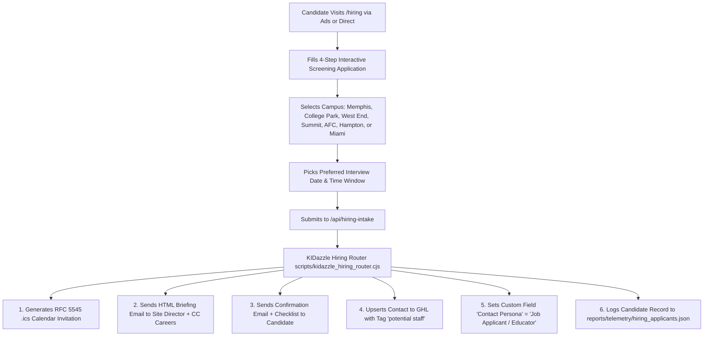

# 📋 KIDazzle Master Educator Hiring Packet & Onboarding Specification

**Version:** 2026.1  
**Organization:** KIDazzle Early Learning Academy / Child Care, Inc.  
**System Target:** GoHighLevel CRM Location `ZR2UvxPL2wlZNSvHjmJD` & Multi-Campus Hiring Engine  
**Authorized Locations:**  
1. Memphis Flying Start (FAA Center, Memphis, TN) — `memphis@kidazzle.com`  
2. Little Flyers College Park (College Park, GA) — `collegepark@kidazzle.com`  
3. Historic West End Atlanta (Atlanta, GA) — `westend@kidazzle.com`  
4. Peachtree Summit Midtown Atlanta (Atlanta, GA) — `summit@kidazzle.com`  
5. Atlanta Federal Center (AFC Downtown, Atlanta, GA) — `afc@kidazzle.com`  
6. Hampton FAA Center (Hampton, GA) — `hampton@kidazzle.com`  
7. Tailwinds Miami / Doral (Doral, FL) — `miami@kidazzle.com`  
**Corporate Recruitment Oversight:** `careers@kidazzle.com` | `roberthill@kidazzle.com`

---

## 🎯 Executive Summary & Purpose
This document codifies the end-to-end recruitment, interview scheduling, and onboarding packet workflow for KIDazzle Early Learning Academy. It establishes a secondary structured data store in GoHighLevel (GHL) ensuring 100% state licensing compliance (Georgia DECAL, Tennessee DHS, Florida DCF, CACFP, and NAEYC Star 3 standards) while isolating staff recruitment from parent enrollment pipelines.

---

## 🌐 Public Hiring & Interview Landing Page Endpoints

All incoming ad campaigns, Indeed listings, and career links route to the unified interactive landing page deployed on the KIDazzle site:

| Route / Subdomain | Destination Purpose | Live Engine |
| :--- | :--- | :--- |
| `https://kidazzle.com/hiring/` | Primary High-Converting Hiring & Interview Booking Portal | Edge Server / Static Mirror |
| `https://kidazzle.com/interview/` | Direct Interview Reservation Portal | Static Alias |
| `https://kidazzle.com/hire/` | Paid Ad Campaign Shortlink | Static Alias |
| `https://kidazzle.com/careers/apply/` | Full Educator Application | Direct Mirror |
| `https://kidazzle.bullmight.com/hiring` | Staging Edge Carbon Copy Endpoint | PM2 #24 (`kidazzle-edge-3025`) |

---

## ⚡ Automated Candidate Dispatch & Routing Workflow

When a candidate applies on `/hiring`:

---

## 🏷️ GHL System Fields & Tags

To maintain zero pollution of parent leads, every applicant is tagged and mapped using exact GHL Custom Fields:

### Mandatory Contact Tags
- `potential staff` (Primary recruitment tag required by Director Robert Hill)
- `contact_type:staff_applicant`
- `hiring-applicant`
- `campus:<campus_key>` (e.g. `campus:memphis`, `campus:collegepark`, `campus:westend`, `campus:summit`, `campus:afc`, `campus:hampton`, `campus:miami`)
- `role:<target_position>`

### Core GHL Custom Fields
| Custom Field Name | GHL Field Key | Field ID | Value Format |
| :--- | :--- | :--- | :--- |
| **Contact Persona** | `contact.contact_persona` | `MdeNltxcWKBWEbLPcRMg` | `"Job Applicant / Educator"` |
| **Desired Hourly Pay** | `contact.pago_por_hora_deseado` | `bNWf1Lxm1tymzqmvMLvA` | e.g. `"$18.00 - $20.00 / hr"` |
| **Target Start Date** | `contact.posible_fecha_de_inicio` | `1V2OmkrVFUT7DwHK7PzF` | `YYYY-MM-DD` |
| **Past Childcare Experience** | `contact.qu_experiencias_ha_tenido_con_el_cuidado_de_nios_en_el_pasado` | `TB5VoPkkEh2vpGqS2dPD` | Text string / Narrative |
| **State-Approved Training** | `contact.describe_your_state_approved_training...` | `n8ekOcywGe6pkmizUAFX` | e.g. `"ECE 40-Hr, CPR, Mandated Reporter"` |
| **Interview Location / Campus** | `contact.the_location_you_would_like_to_interview_with...` | `wM5sibWTRTfRyMW6upaY` | Full Campus Name |
| **Candidate Questions** | `contact.do_you_have_any_question_for_the_interview...` | `VAepOlgpHygUn1PRKzFw` | Candidate questions text |
| **Interview Date** | `contact.choose_your_best_time_to_book_an_appointment_for_interview` | `X4BsYu3RKSGWliNZFUdy` | `YYYY-MM-DD` |
| **Interview Time Slot** | `contact.choose_your_best_time__employment_interview` | `BognBVk26YeBHEknt90d` | e.g. `"10:30 AM"` |
| **Bilingual Status** | `contact.eres_bilingue` | `jIV33QC2CMSRTTd5Lqnm` | e.g. `"Bilingual English & Spanish"` |

---

## 📦 Master Hiring Packet Checklist (Post-Offer Onboarding)

When a candidate is offered employment, the Director completes the 7-part onboarding dossier:

### 1. Form I-9 & Employment Eligibility
- [ ] Section 1 completed by employee on or before Day 1.
- [ ] Section 2 physical examination of documents completed by Director within 3 business days of hire.
- [ ] Unexpired List A document (e.g. US Passport, Permanent Resident Card) OR List B + List C documents (Driver's License + Social Security Card / Birth Certificate) copied and retained in confidential file.

### 2. Tax Withholding & Banking
- [ ] Federal Form W-4 completed and signed.
- [ ] State Withholding form (GA G-4 for Georgia campuses) on file.
- [ ] Direct Deposit Authorization form with attached voided check or official bank verification letter.

### 3. Georgia DECAL / State Regulatory Credentials
- [ ] GaPDS (Georgia Professional Development System) Profile ID registered and verified.
- [ ] Official High School Diploma, College Transcripts, or verified CDA / TCC credential copy on file.
- [ ] DECAL Comprehensive Criminal Background Determination Letter on file (FBI/GBI LiveScan fingerprint clearance).
- [ ] 10-Year Continuous Employment History verification form completed with zero unexplained gaps.
- [ ] 2 Written / Telephone Verified Professional References documented with dates and director signature.

### 4. Health, Medical & Safety Clearances
- [ ] Bright from the Start Form 104 (Employee Health Examination) signed by licensed physician or PA within last 12 months.
- [ ] Negative TB (Tuberculosis) screening documentation on file (Mantoux PPD skin test or chest X-ray clearance).

### 5. Mandatory Orientation & Certifications
- [ ] ECE 40-Hour Health & Safety Orientation certificate completed.
- [ ] Georgia Mandated Reporter Child Abuse & Neglect certificate.
- [ ] Active Pediatric First Aid & Infant/Child CPR card on file.
- [ ] CACFP Civil Rights & Food Sanitation training documented.
- [ ] Georgia Quality Rated Star 3 & GELDS curriculum orientation.

### 6. Corporate Policies & Benefits
- [ ] Signed Employee Handbook & Code of Conduct acknowledgment.
- [ ] Signed Confidentiality & Non-Disclosure Agreement (NDA).
- [ ] Signed Child Abuse Prevention & Mandated Reporting commitment.
- [ ] Signed Classroom Cell Phone & Social Media policy.
- [ ] Section 125 Pre-Tax Cafeteria Plan Election form (Medical, Dental, Vision, Pre-Tax Deductions via Shielded Horizon / Manhattan Life).
- [ ] Employee Childcare Tuition Discount agreement (50% reduction for staff children).

### 7. Roster Setup & Operational Readiness
- [ ] Assigned to primary classroom (Infants, Toddlers, 2s, 3s, Pre-K, Floater, Nutrition).
- [ ] Work shift schedule established (Opening, Core Mid, Closing).
- [ ] Keycard / Building Door Pin code issued.
- [ ] Uniform shirts / scrubs issued.
- [ ] GHL tag updated from `potential staff` to `current_staff`.
